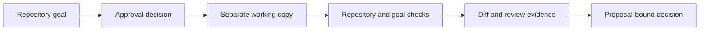

# Keep

**Repository automation with explicit control.**

Keep turns a repository goal into a tested, reviewable change proposal. It prepares edits in a separate working copy and records the tests, decisions and recovery state behind the result. The project explores how to give AI agents useful responsibility while keeping consequential actions accountable.

## Try the preview

Install the [Linux x64 preview](docs/quickstart.md), then run:

```sh
keep demo project
```

The walkthrough creates a sample repository, proposes a change, runs its tests and prints the actual diff. It also checks approval before dispatch, restart without replay, rejection of a wrong token, and source preservation after veto. Open the printed evidence directory to inspect the files and results.

```text
PASS  Approval gate held: 0 model calls before sample approval
PASS  Materialized change: retry limit 0 → 7
PASS  Tests: limit; goal: requested outcome
PASS  Restart retained the proposal without replay
PASS  Wrong token refused; exact proposal vetoed; original source unchanged
```

The demo uses **two scripted local responses and simulated approval/veto decisions**, with no model account or paid request. The workspace edits, tests and retained artifacts are real. You need Node.js 22.23.2, npm and Git; installation needs no Rust or C compiler. [Walkthrough and evidence](docs/portfolio-walkthrough.md).

## How it works



- **Separate proposal from source.** Inspect the proposed files and tests before an authorized landing operation.
- **Bind decisions to the result.** Review controls identify the exact proposal; recording a decision does not grant missing execution authority.
- **Retain interrupted work.** Durable project records distinguish pending, completed and uncertain outcomes instead of assuming a retry is safe.
- **Make limits visible.** The demo's best-effort isolation and the opt-in required project jail have different prerequisites and evidence.

[Architecture and trust boundaries](docs/architecture.md) · [Security model](SECURITY.md) · [Validation evidence](docs/evidence.md)

## Current status

| Component | Status |
|---|---|
| Download | **0.0.12-preview.1**, qualified Linux x64 research preview. [Release and checksums](https://github.com/RedRookAI/keep-research-preview/releases/tag/keep-preview-2026-10-05.1). |
| Development source | **0.0.16-preview.1**. Adds a native-project browser console with saved local instance controls, exact decisions, diffs and check results. The Codex account integration remains experimental and its installed workflow remains unqualified. No matching qualified download is published. [Status and limits](docs/codex-project.md). |
| OpenClaw | Development candidate's packaged plugin passed the controlled native OpenClaw workflow: restricted submission/status, separate human approval, tested proposal and fresh-process recovery. Genuine Codex work and a qualified combined download remain pending. [Client setup and limits](integrations/openclaw/README.md). |

Keep is a research preview. The supplied demonstrations establish specific workflow and recovery behavior, with developer-administered evidence. They do not establish general model quality, production enterprise isolation or independently audited security. [Supported scope and roadmap](ROADMAP.md).

## Documentation

- [Install and run](docs/quickstart.md) and [operate a development instance](docs/local-instance.md)
- [Configure repository work](docs/installed-solve.md) and [experimental Codex access](docs/codex-project.md)
- [OpenClaw client candidate](integrations/openclaw/README.md) and [restricted client admission](docs/openclaw-client.md)
- [Recovery experiment](docs/research-preview.md) and [backup compatibility](docs/backup.md)
- [Memory](docs/semantic-memory.md), [skill registry](docs/skill-registry.md) and [usage accounting](docs/monetary-accounting.md)
- [Build and contribute](WORKFLOW.md)
- [Release identities](KEEP_RELEASE.md), [license and attribution](docs/licensing.md)

Released under the [MIT license](LICENSE).
