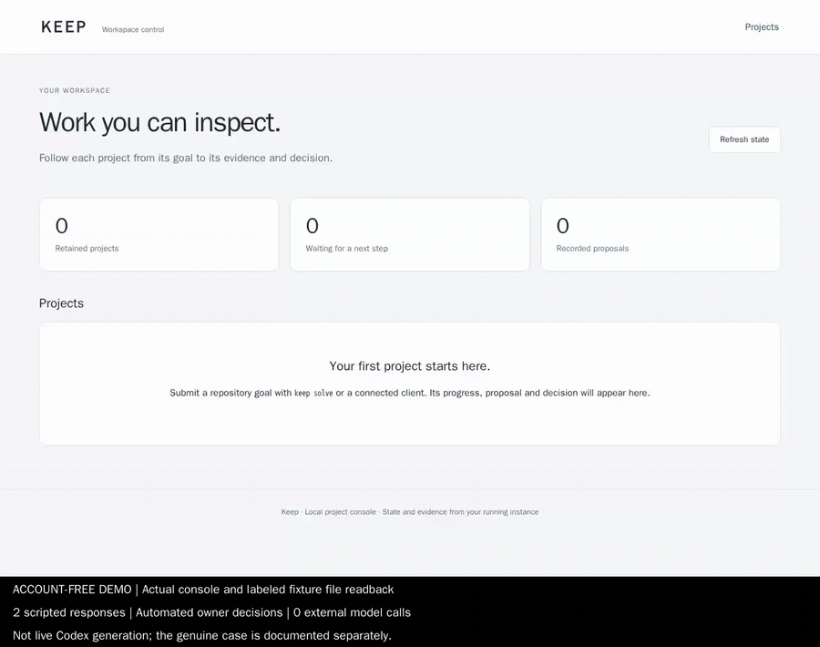

# Keep

**AI-generated repository changes you can inspect before they reach your source.**

Coding agents can produce a plausible patch while leaving the owner to reconstruct what ran, what changed and whether it is safe to retry. Keep turns a repository goal into a checked proposal in a separate working copy, with retained execution evidence and decisions tied to the exact result.

## See the working preview

[](https://github.com/RedRookAI/keep-research-preview/releases/download/keep-portfolio-2026-10-21.1/keep-account-free-demo.mp4)

**Recorded account-free demonstration:** actual Keep console, workspace edits, executable checks, proposed diff, veto and recovery. The two model responses are **scripted locally**; an automated fixture **simulates the owner's approval and veto through the real controls**. No external model request is made. [Watch the MP4](https://github.com/RedRookAI/keep-research-preview/releases/download/keep-portfolio-2026-10-21.1/keep-account-free-demo.mp4) · [Text description, recording details and evidence](docs/portfolio-demo.md).

**Separate genuine result:** Codex produced a working Unicode-regex fix through Keep and the native OpenClaw plugin. The unchanged predefined checker passed all three cases; fresh-process status recovered the job, and exact veto preserved the original source. Codex generation was real; OpenClaw tool selection was scripted and decisions were developer-administered. [Inspect the patch, historical console capture and execution record](docs/genuine-codex-walkthrough.md). This is one integration case, not a model success-rate benchmark.

## Run it today

The **0.0.19-preview.1** combined Linux x64 download contains Keep, bundled TypeScript, the measured generation-only Codex engine and the restricted OpenClaw plugin. Extract the archive and select its supported Node 22 runtime; no npm installer or compiler is needed for this route.

```sh
./bin/keep demo project
```

This runnable account-free walkthrough creates its own sample repository, makes a real workspace edit, executes its checks and prints the actual diff. Its disclosed scripted responses and simulated decisions also exercise restart, wrong-token refusal and veto. [Install and run](docs/quickstart.md) · [Walkthrough and artifacts](docs/portfolio-walkthrough.md).

For your own authorized public repository, use your existing Codex login and the bundled engine, configure the repository/check command, then operate an owned Keep instance. OpenClaw's `keep_submit` and `keep_status` tools use that same runtime; decisions stay in Keep's console. [Codex setup](docs/codex-project.md) · [Instance and console](docs/local-instance.md) · [OpenClaw setup](integrations/openclaw/README.md).

The observed profile is Linux x64 with the Ubuntu 24.04 library baseline, Node 22.23.3 for Keep and OpenClaw 2026.10.5 on Node 24.22.0. Required-jail work additionally needs the measured Bubblewrap helper and working namespaces. [Runtime/dependency conditions](docs/dependency-status.md) · [Exact release identities](KEEP_RELEASE.md). The older archives retain an example-file export defect; the [corrected example download](docs/genuine-codex-walkthrough.md#example-export-correction) repairs that file without changing the runtime or rewriting historical receipts.

## Engineering mechanisms

| Mechanism | Implemented behavior |
|---|---|
| Separate workspaces | Materialize a pinned repository revision and prepare edits outside the original source tree. |
| Validated edits | Check structured edit plans and applicability before applying changes; literal replacements preserve intended bytes. |
| Executable checks | Run the repository's checks and the goal check, retaining results beside the proposed diff. Passing generated checks alone does not establish correctness. |
| Durable recovery | Retain jobs, proposals, request identities and uncertain effects across restart; do not assume a lost response makes replay safe. |
| Proposal-bound decisions | Bind approval/veto to the exact proposal digest. A recorded decision does not grant missing landing authority. |
| Restricted OpenClaw integration | Give the client separate expiring/revocable submission/status authority, with a durable journal; its tools cannot approve or merge. |

## Design choices and tradeoffs

Keep separates generation from execution and review. That makes an actual patch and its checks easier to inspect than a model's claim of success, at the cost of configuration and explicit state to recover. Durable uncertainty can require reconciliation instead of an automatic retry; that is deliberate when an external effect may already have happened.

The OpenClaw plugin is a thin client of Keep's existing runtime, rather than a second solver. Native plugin code and the host remain trusted. The default demo's best-effort process boundary and the opt-in required namespace jail have different guarantees; neither is production enterprise certification.

Keep is a **research preview**. The shipped artifact has scoped installed checks and the genuine case above; it does not establish general model quality, live enterprise custody/isolation, platform parity or independently audited security. [Architecture](docs/architecture.md) · [Security boundaries](SECURITY.md) · [Observed evidence](docs/evidence.md) · [Remaining scope](ROADMAP.md).

## People, assistance and further inspection

Keep is a Red Rook AI portfolio project. Product direction and acceptance requirements are owner-led. Implementation, debugging, checks and documentation have been developed with substantial AI assistance, including Codex. The evidence distinguishes generated work, scripted fixtures and developer-administered decisions; it does not attribute every line to unaided human authorship or claim an independent audit.

[Build and contribute](WORKFLOW.md) · [Recovery and backup](docs/backup.md) · [Memory](docs/semantic-memory.md) · [Skill registry](docs/skill-registry.md) · [Usage accounting](docs/monetary-accounting.md) · [License and attribution](docs/licensing.md).

Keep's original code is released under the [MIT license](LICENSE); third-party components retain their own terms.
