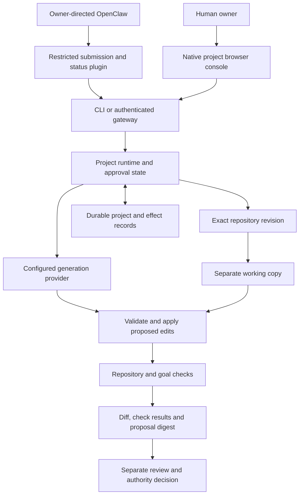

# Architecture

Keep connects a project goal, pinned source, a separate workspace, executable checks and a reviewable proposal. The CLI, gateway and restricted OpenClaw client use the same project runtime.

## Follow a change

1. **Admit and check the edit.** The solve pipeline binds project edits to repository content and fixed goal checks.
2. **Review the proposal.** Landing verifies the exact proposal digest, retained evidence and current source.
3. **Recover interrupted work.** The project loop records in-flight effects. The checkpoint store persists revisions with compare-and-swap.
4. **Inspect the tests.** The guided demo checks source/workspace bytes and exports. Checkpoint tests race separate processes against persisted state.

https://github.com/RedRookAI/keep-research-preview/blob/main/src/solve/solve_pipeline.ts

https://github.com/RedRookAI/keep-research-preview/blob/main/src/solve/governed_local_merge.ts

https://github.com/RedRookAI/keep-research-preview/blob/main/src/autonomy/project_loop.ts

https://github.com/RedRookAI/keep-research-preview/blob/main/src/autonomy/project_checkpoint_store.ts

https://github.com/RedRookAI/keep-research-preview/blob/main/test/guided_demo.test.ts

https://github.com/RedRookAI/keep-research-preview/blob/main/test/project_checkpoint_store.test.ts

## Authority and execution

The gateway authenticates callers and checks permissions at each supported operation. Human proposal decisions carry the deciding principal and exact result. The browser console uses the same API with origin/CSRF checks. The OpenClaw client's separate credential permits its own submission/status operations; proposal approval stays with the human.

Repository checks run in a separate workspace. The prepared walkthrough uses authored responses, while the retained Codex case used real generation. Predefined repository expectations and the separate goal check determine the recorded result.

The default walkthrough uses best-effort process isolation. Required-jail mode verifies a measured Bubblewrap launcher and refuses unsupported setup. The host kernel, system tools and administrator remain trusted. Filesystem, network and resource limits are described in Security.

https://github.com/RedRookAI/keep-research-preview/blob/main/SECURITY.md

## Persistence and recovery

Project state, proposal artifacts and dispatch/accounting records retain the original request, source, authority, changes, checks and decision. Hash-linked records bind recorded bytes; completeness depends on the recorder and administrator.

Lost responses and timeouts can leave an external outcome uncertain. Recovery inspects that original operation before retrying. Restoring local state leaves outside-service effects intact and requires current authority to be reconciled before writers restart.

The OpenClaw client records its canonical goal/key in a private SQLite journal before HTTP; Keep uses a durable idempotency journal. A fresh conversation or lost response recovers the same request/job. Backup includes client/session state, configuration, repository contents and permissions.

https://github.com/RedRookAI/keep-research-preview/blob/main/docs/backup.md

## OpenClaw integration

The native plugin runs in the trusted OpenClaw process and calls Keep's runtime through `keep_submit` and `keep_status`. The example profile disables native catalog wrappers. Its compatibility fixture checked the selected tools and protected the fixture's owner/auth files and source under that Linux setup.

The plugin and Keep have separate Node requirements. The integration guide records supported versions, setup and dependency conditions. The client admission contract describes credential expiry/revocation, original caller identity and rechecks before dispatch.

https://github.com/RedRookAI/keep-research-preview/blob/main/integrations/openclaw/README.md

https://github.com/RedRookAI/keep-research-preview/blob/main/docs/openclaw-client.md

## Implementation entry points

| Responsibility | Source |
|---|---|
| Composition and installed configuration | [compose.ts](../src/compose.ts), [runtime_config.ts](../src/cli/runtime_config.ts) |
| Authenticated project API | [http_gateway.ts](../src/gateway/http_gateway.ts) |
| Native browser controls | [project_console.ts](../src/review/project_console.ts), [review_web.ts](../src/review/review_web.ts) |
| Restricted client and native OpenClaw plugin | [restricted_client.ts](../src/gateway/restricted_client.ts), [OpenClaw integration](../integrations/openclaw/README.md) |
| Project execution, jobs and original command identity | [project_runtime.ts](../src/session/project_runtime.ts), [project_job_journal.ts](../src/session/project_job_journal.ts), [project_command.ts](../src/session/project_command.ts) |
| Edit/test/proposal integration | [project_loop_wiring.ts](../src/solve/project_loop_wiring.ts) |
| Required project jail | [required_project_jail.ts](../src/infra/required_project_jail.ts) |
| Experimental Codex transport and admission | [codex_account_client.ts](../src/gateway/codex_account_client.ts), [codex_project_provider.ts](../src/gateway/codex_project_provider.ts) |
