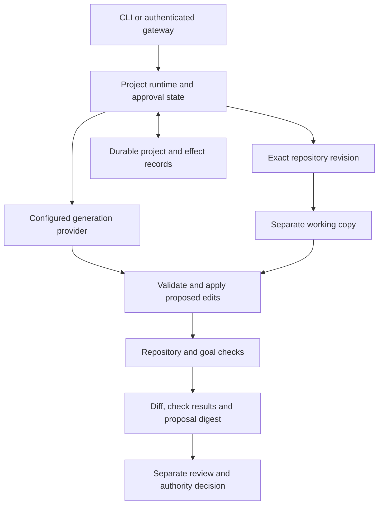

# Architecture and trust boundaries

Keep's repository workflow connects a goal, an exact source revision, a separate working copy, executable checks and a reviewable proposal. The CLI and authenticated gateway use the same composed project runtime.

The downloadable walkthrough uses controlled local responses in place of a live provider. The experimental Codex source uses a signed-in native CLI for remote generation. OpenClaw's planned role is a restricted client of this workflow; it is not yet an implemented runtime connection.

## The main boundaries

**Request and authority.** Gateway authentication and permission checks govern specific operations. The personal gateway's owner token carries owner authority; it is not currently a restricted OpenClaw integration credential. Proposal decisions identify the exact result and remain subject to the actual landing authority.

**Source and generated work.** Repository materialization starts from an exact commit. Proposed edits and tests run in a separate workspace. Model output is input to validation, not proof that a change is correct. Passing an authored goal check does not replace predefined repository expectations.

**Test execution.** The default walkthrough reports best-effort process isolation. The opt-in required project jail uses a measured Bubblewrap launcher and refuses missing or mismatched prerequisites. Its supported filesystem, networking and resource boundaries are described in [Security](../SECURITY.md#opt-in-required-project-boundary-experimental); it is not a VM or a universal hostile-workload guarantee.

**Persistence and uncertain effects.** Project state and dispatch/accounting records support inspection across restart. A lost response, timeout or local child exit may leave an external outcome unknown. Retaining that uncertainty prevents an automatic retry from being mistaken for a safe operation. Local restore does not undo effects in outside services or revive revoked authority.

**Evidence.** Diffs, test results and records make behavior inspectable. Hash-linked records bind recorded data; they do not independently establish that every event is truthful or complete. Current qualification was administered by the developer on controlled fixtures.

## Planned OpenClaw client

The selected design is a thin optional submission/status tool plugin targeting OpenClaw 2026.10.5. It calls Keep's project runtime; it does not introduce another solver. The plugin and Keep run as separate processes: the selected OpenClaw package requires Node 24.16+ on the Node 24 line, or Node 26.1+, while Keep retains its documented Node 22 runtime. This design is not yet implemented or installed.

The client will receive a separate expiring, revocable credential for its configured repository and own-job status. Human generation approval remains in Keep. The approval handoff must preserve the original submitting agent and grant, and recheck both human approval authority and the agent's live authority before dispatch. Giving the plugin the owner's bearer token would not meet that contract.

Submission will reuse Keep's durable idempotency journal. A lost response must recover the same request/job; a fresh tool-call identifier cannot establish that earlier work did not happen. The example profile must exclude direct execution and source/credential access through other tools, with its actual catalog and process boundaries checked in an owned fixture. Native plugin code remains trusted OpenClaw host code. [Upstream tool-plugin interfaces](https://docs.openclaw.ai/plugins/tool-plugins) inform this design; they do not qualify Keep's integration.

## Implementation entry points

| Responsibility | Source |
|---|---|
| Composition and installed configuration | [compose.ts](../src/compose.ts), [runtime_config.ts](../src/cli/runtime_config.ts) |
| Authenticated project API | [http_gateway.ts](../src/gateway/http_gateway.ts) |
| Project execution, jobs and original command identity | [project_runtime.ts](../src/session/project_runtime.ts), [project_job_journal.ts](../src/session/project_job_journal.ts), [project_command.ts](../src/session/project_command.ts) |
| Edit/test/proposal integration | [project_loop_wiring.ts](../src/solve/project_loop_wiring.ts) |
| Required project jail | [required_project_jail.ts](../src/infra/required_project_jail.ts) |
| Experimental Codex transport and admission | [codex_account_client.ts](../src/gateway/codex_account_client.ts), [codex_project_provider.ts](../src/gateway/codex_project_provider.ts) |

[Run the walkthrough](portfolio-walkthrough.md) · [Inspect the evidence](evidence.md) · [Product roadmap](../ROADMAP.md)
