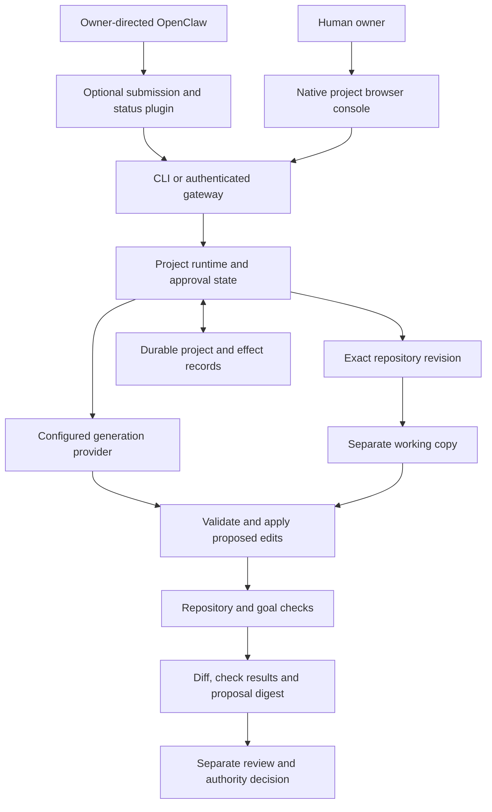

# Architecture and trust boundaries

Keep's repository workflow connects a goal, an exact source revision, a separate working copy, executable checks and a reviewable proposal. The CLI and authenticated gateway use the same composed project runtime.

The downloadable walkthrough uses controlled local responses in place of a live provider. The experimental Codex source uses a signed-in native CLI for remote generation. Development source 0.0.16 adds the restricted OpenClaw client and native project console shown above. The packaged plugin passed its controlled installed SDK workflow; genuine Codex output and the final combined download remain unqualified. The 0.0.12 qualified download predates these additions.

## The main boundaries

**Request and authority.** Gateway authentication and permission checks govern specific operations. The personal gateway's owner token carries owner authority and stays separate from the development OpenClaw client's narrow credential. Proposal decisions identify the exact result and remain subject to the actual landing authority. The console forwards to the same API under the authenticated human principal, with browser origin/CSRF checks; it does not give agent tools approval authority.

**Source and generated work.** Repository materialization starts from an exact commit. Proposed edits and tests run in a separate workspace. Model output is input to validation, not proof that a change is correct. Passing an authored goal check does not replace predefined repository expectations.

**Test execution.** The default walkthrough reports best-effort process isolation. The opt-in required project jail uses a measured Bubblewrap launcher and refuses missing or mismatched prerequisites. Its supported filesystem, networking and resource boundaries are described in [Security](../SECURITY.md#opt-in-required-project-boundary-experimental); it is not a VM or a universal hostile-workload guarantee.

**Persistence and uncertain effects.** Project state and dispatch/accounting records support inspection across restart. A lost response, timeout or local child exit may leave an external outcome unknown. Retaining that uncertainty prevents an automatic retry from being mistaken for a safe operation. Local restore does not undo effects in outside services. It also cannot discover revocations made after the snapshot: current authority must be reconciled before restored writers are activated. [Component recovery](backup.md#recovering-the-openclaw-client-candidate) includes the separate client journal and session state.

**Evidence.** Diffs, test results and records make behavior inspectable. Hash-linked records bind recorded data; they do not independently establish that every event is truthful or complete. Current qualification was administered by the developer on controlled fixtures.

## OpenClaw development candidate

The optional native plugin targets OpenClaw 2026.10.5 and calls Keep's existing project runtime. The plugin runs inside the trusted OpenClaw process, separate from Keep; no second solver is introduced. The candidate's Node engine floor is 24.18.1 on the Node 24 line, or 26.5.1 and later, while Keep retains its documented Node 22 runtime. These are compatibility floors, not final security admission. Exact runtime selection and current security notices are covered in the [plugin guide](../integrations/openclaw/README.md).

Keep's implemented client admission issues a separate expiring, revocable credential bound to the configured project runtime. Its authenticated routes submit a goal and inspect the original own job. Human generation approval remains in Keep. The handoff records the deciding human separately, preserves the original submitting agent and grant, and rechecks live authority/source before dispatch. The scoped Keep-side controlled checks have passed; that does not establish native OpenClaw loading or live-account success. [Admission contract](openclaw-client.md).

The client records the canonical goal/key in a private SQLite journal before HTTP; the server uses its existing durable idempotency journal. A lost response recovers the same request/job. The outstanding conversation survives a session reset, so a fresh tool-call identifier cannot establish that earlier work did not happen. The journal contains private submitted text and must be retained with matching client/session state.

The example profile allows only `keep_submit` and `keep_status`, with native catalog wrappers disabled. The controlled installed check captured those exact tools on outgoing model requests and verified that its unprivileged client could not read the fixture's owner/auth files or write its source. That measured Linux profile is not automatic isolation of every installation. Native plugin code remains trusted OpenClaw host code; neither the tool allowlist nor Keep's separate repository test jail confines a malicious plugin or host administrator. [Compatibility evidence](qualification/openclaw-2026-10-20.json) and [upstream tool-plugin interfaces](https://docs.openclaw.ai/plugins/tool-plugins).

## Implementation entry points

| Responsibility | Source |
|---|---|
| Composition and installed configuration | [compose.ts](../src/compose.ts), [runtime_config.ts](../src/cli/runtime_config.ts) |
| Authenticated project API | [http_gateway.ts](../src/gateway/http_gateway.ts) |
| Native browser controls | [project_console.ts](../src/review/project_console.ts), [review_web.ts](../src/review/review_web.ts) |
| Restricted client and native OpenClaw plugin | [restricted_client.ts](../src/gateway/restricted_client.ts), [OpenClaw integration](../integrations/openclaw/README.md) |
| Project execution, jobs and original command identity | [project_runtime.ts](../src/session/project_runtime.ts), [project_job_journal.ts](../src/session/project_job_journal.ts), [project_command.ts](../src/session/project_command.ts) |
| Edit/test/proposal integration | [project_loop_wiring.ts](../src/solve/project_loop_wiring.ts) |
| Required project jail | [required_project_jail.ts](../src/infra/required_project_jail.ts) |
| Experimental Codex transport and admission | [codex_account_client.ts](../src/gateway/codex_account_client.ts), [codex_project_provider.ts](../src/gateway/codex_project_provider.ts) |

[Run the walkthrough](portfolio-walkthrough.md) · [Inspect the evidence](evidence.md) · [Product roadmap](../ROADMAP.md)
