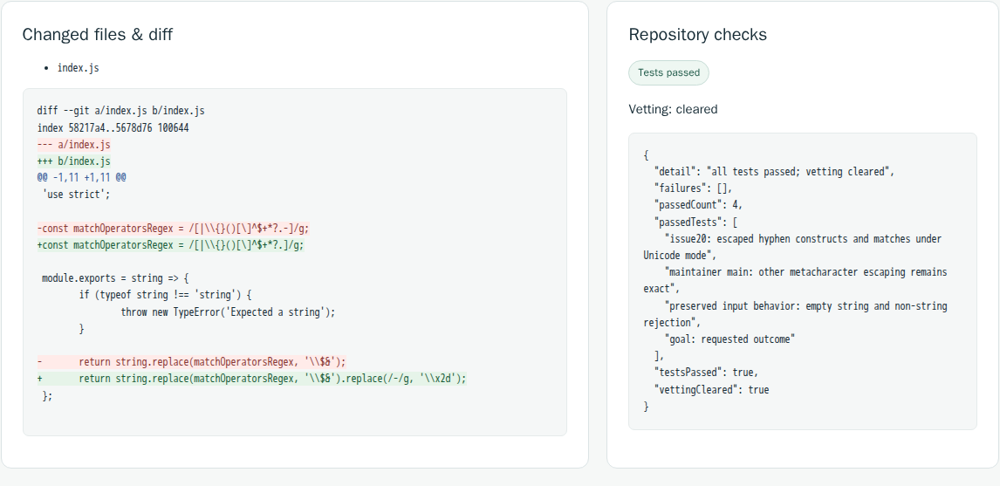

# A genuine Codex repository result

Keep used Codex to fix a Unicode-regex bug in the pinned v2.0.0 source of escape-string-regexp. Escaping a hyphen as `\-` caused Unicode regular-expression construction to fail. The generated patch changes only `index.js`, encoding hyphens as `\x2d`.

Upstream issue:

https://github.com/sindresorhus/escape-string-regexp/issues/20



Inspect the [patch](examples/codex-unicode/proposal.patch), [unchanged checker](examples/codex-unicode/check.mjs), [test output](examples/codex-unicode/independent-check.tap) and [execution record](examples/codex-unicode/result.json) without an account or installation. The upstream [MIT license](examples/codex-unicode/UPSTREAM-LICENSE) is retained.

## What ran

The October 20, 2026 run used private development 0.0.17-preview.1 core/plugin packages. They contained repairs published in source 0.0.18-preview.1 and carried into the historical 0.0.19-preview.1 combined release. The public source17 checkpoint predates those repairs.

Native OpenClaw submitted the goal through `keep_submit` and `keep_status`. The developer approved generation in Keep's browser console. The source-derived Codex 0.163.0 generation.2 engine used an existing ChatGPT login and produced the edit and goal test in two completed CLI invocations. Keep applied the edits in a separate workspace and ran the checks.

The predefined checker found one failure and two passes in the original source. All three passed in the proposed workspace under the required namespace jail: Unicode hyphen matching, other metacharacter escaping, and empty/non-string input behavior. A fresh OpenClaw process recovered the same job. The developer vetoed the exact proposal, preserving the original source.

Codex generation was live; OpenClaw tool selection was scripted. Earlier transport failures and an unapplyable plan are retained in the record. The work led to fixes for browser-origin compatibility, literal replacement and early applicability checking. This is one integration case on a historical issue that may overlap model training data. Provider-internal retries and allocated subscription dollar cost are unknown.

## Example export correction

On October 21, the 486-byte `proposal.patch` export was corrected by adding a missing final newline. The original file caused `git apply` to report a corrupt patch. The corrected 487-byte file has SHA256 `7765803bb65d27cb5a54d19c08bc5fc407a23cfa4bb70db23e5f33b8a751d77c`.

On a fresh checkout of the pinned upstream commit, applying the corrected file directly and running the unchanged `check.mjs` changed the baseline from one failure/two passes to three passes. This reproduction made no new model request.

[Correction record and current hashes](examples/codex-unicode/export-correction-2026-10-21.json).

Corrected standalone download:

https://github.com/RedRookAI/keep-research-preview/releases/download/keep-portfolio-2026-10-21.1/keep-codex-unicode-example-2026-10-21.tar.gz

The October 20 combined, core npm and source archives retain the defective export. The plugin and native source-support archives do not contain it. Use the current source example or corrected standalone download. The correction retained runtime 0.0.19-preview.1; current release identities are in the [release record](../KEEP_RELEASE.md).

`result.json` and `independent-check.tap` retain the October 20 execution identities, including the old patch hash. The correction record identifies the repaired file. The screenshot above is from that original Codex case.

## Verify the recorded patch locally

From the Keep source checkout, use a patched Node 22 runtime and a new specimen directory:

```sh
export KEEP_EXAMPLE="$(pwd)/docs/examples/codex-unicode"
git clone https://github.com/sindresorhus/escape-string-regexp.git keep-specimen
git -C keep-specimen switch --detach 21c557c7f14a112eebe196abd98d085f5fcfcf5e
git -C keep-specimen apply "$KEEP_EXAMPLE/proposal.patch"
KEEP_CASE_SOURCE="$(pwd)/keep-specimen" node "$KEEP_EXAMPLE/check.mjs"
```

Expected result: three passing tests. These commands apply the recorded patch without generating another response.

## Try your own repository

Configure the [Codex role](codex-project.md), [local instance](local-instance.md) and optional [restricted OpenClaw plugin](../integrations/openclaw/README.md). Submit a bounded goal, approve preparation, inspect the diff/checks and decide the exact proposal. The [combined preview](combined-preview.md) supplies the measured generation-only executable and source support; its release record names the tested archive.
