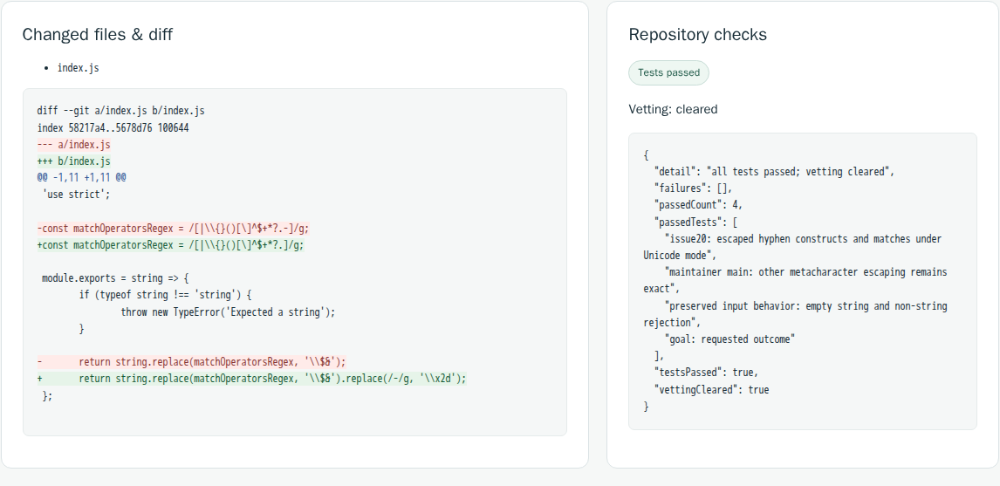

# A genuine Codex repository result

Keep completed a developer-administered follow-up on [escape-string-regexp issue 20](https://github.com/sindresorhus/escape-string-regexp/issues/20): a hyphen escaped by the pinned v2.0.0 source could not construct a Unicode regular expression. The generated change removes hyphens from identity escaping and encodes them as `\x2d`. It changes only `index.js`.



This is a capture of the actual retained console panels after the exact proposal was vetoed. The [patch](examples/codex-unicode/proposal.patch), [unchanged independent checker](examples/codex-unicode/check.mjs), [test output](examples/codex-unicode/independent-check.tap) and [historical execution record](examples/codex-unicode/result.json) are available without an account or installation. Upstream code is MIT-licensed; its [license](examples/codex-unicode/UPSTREAM-LICENSE) is retained.

## What ran

The measured core/plugin packages were private development 0.0.17-preview.1 bytes containing the repairs published in source 0.0.18-preview.1 and carried into the current 0.0.19-preview.1 combined release; the public source17 checkpoint predates those repairs. The native OpenClaw plugin submitted the repository goal using only `keep_submit` and `keep_status`. A separate owner decision in Keep's browser console released generation. The source-derived Codex 0.163.0 generation.2 engine used the existing ChatGPT login and produced the edit and goal test in two completed CLI invocations. Keep applied the admitted edits to its separate working copy, ran repository/goal checks and exposed the exact diff.

The predeclared checker reproduced one failing and two passing behaviors on the original source. On the proposed workspace all three passed under the required namespace jail: Unicode hyphen construction/literal matching, preserved escaping of other metacharacters, and empty/non-string input behavior. A fresh native OpenClaw process retrieved the same job. The console then recorded a veto of the exact proposal; the original source stayed unchanged.

OpenClaw's tool-selection model was scripted locally so only Codex performed live generation. Owner approval/veto were administered by the developer. This was a follow-up, not a first-try success: earlier transport failures and an unapplyable generated plan were retained. The work exposed and repaired real browser-origin compatibility, literal replacement and early applicability-checking defects. The historical issue may overlap model training data; this is an integration/usefulness case, not a success-rate benchmark. Provider-internal retries and allocated subscription dollar cost are unknown.

## Example export correction

On October 21, 2026, following Haymitch's review of `9f7645f`, the published `proposal.patch` was repaired by adding its missing final newline. The original 486-byte export caused ordinary `git apply` to report a corrupt patch. The corrected 487-byte file has SHA256 `7765803bb65d27cb5a54d19c08bc5fc407a23cfa4bb70db23e5f33b8a751d77c`.

A fresh checkout of the exact upstream commit produced one Unicode-hyphen failure and two passes. Applying the actual repaired repository file directly with `git apply`, without normalization, then running the unchanged `check.mjs` produced three passes and zero failures. This is a new patch-reproduction check, not another Codex generation or an independent audit.

[Current export hashes and observed correction](examples/codex-unicode/export-correction-2026-10-21.json) · [Corrected standalone example download](https://github.com/RedRookAI/keep-research-preview/releases/download/keep-portfolio-2026-10-21.1/keep-codex-unicode-example-2026-10-21.tar.gz).

The October 20 combined archive, core npm archive and source archive all contain the defective example file; their original bytes, checksums, tags and qualification receipts remain unchanged. The plugin and native source-support archives do not contain this file. Use the current source example or the corrected standalone download for reproduction. Keep's runtime remains 0.0.19-preview.1; no runtime package was rebuilt by this portfolio pass.

The original `result.json` and `independent-check.tap` retain their historical identities. In particular, `result.json`'s patch hash describes the old export; the correction record supplies the current file identity. The earlier screenshot remains a historical capture of the real Codex case, not footage from the new account-free recording.

## Verify the recorded patch locally

With the Keep source checked out, set `KEEP_EXAMPLE` to this directory's absolute path, then use a new specimen checkout:

```sh
export KEEP_EXAMPLE="$(pwd)/docs/examples/codex-unicode"
git clone https://github.com/sindresorhus/escape-string-regexp.git keep-specimen
git -C keep-specimen switch --detach 21c557c7f14a112eebe196abd98d085f5fcfcf5e
git -C keep-specimen apply "$KEEP_EXAMPLE/proposal.patch"
KEEP_CASE_SOURCE="$(pwd)/keep-specimen" node "$KEEP_EXAMPLE/check.mjs"
```

Expected result: three passing tests, no failures. This verifies the recorded patch; it does not generate another model response. Use a current patched Node 22 runtime.

## Try your own repository

The current source uses Keep's [Codex role](codex-project.md), [owned instance setup](local-instance.md) and [restricted OpenClaw plugin](../integrations/openclaw/README.md). Submit one bounded repository goal through that configured profile, approve its pending step in Keep, inspect the diff/checks and choose a proposal-bound action. The [combined preview](combined-preview.md) includes the measured generation-only executable and its source/attribution support. Use its matching release record for exact-archive qualification and supported dependency conditions. The older qualified download is not relabeled by this example.
