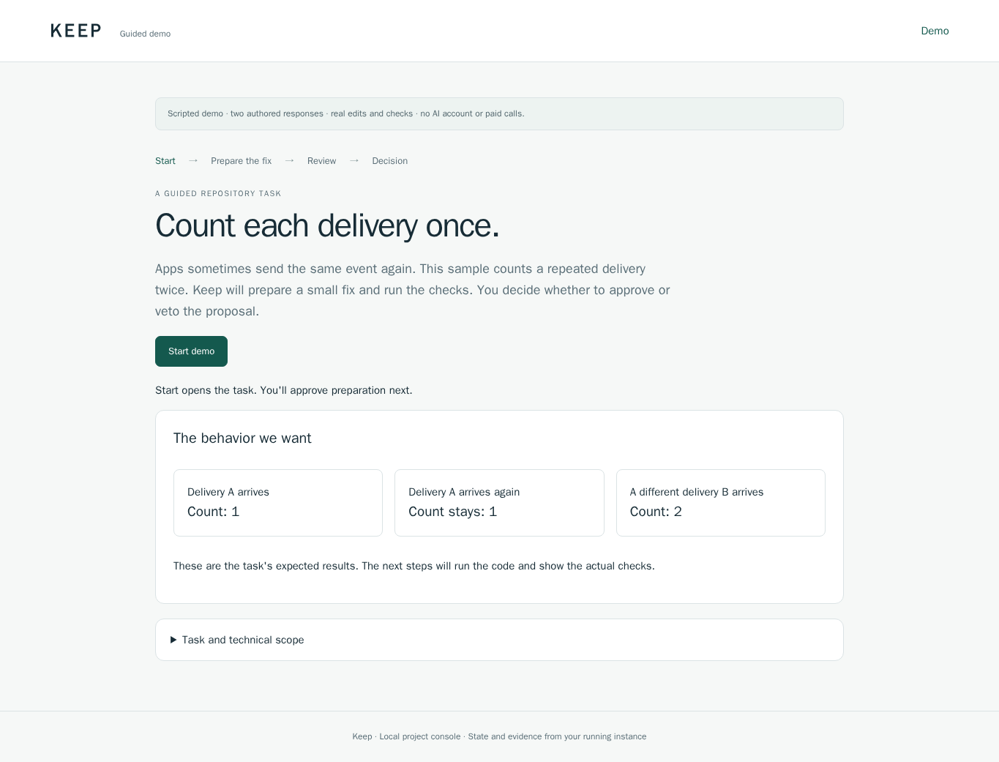

# Try a checked code change

A small webhook handler counts repeated deliveries twice. Keep prepares a fix in a separate workspace, runs four checks and waits for your decision.

Open your assigned invitation and enter the credential supplied separately by the operator:

https://keep-b.redrook.ai/console

1. Choose **Start demo**, then **Prepare the fix**.
2. Review the three repository checks and developer-authored goal check. The hosted .25 interface labels the fourth assertion **Independent goal check**; current source calls it **Goal check**.
3. Open **Inspect the code change** to see the diff.
4. Approve or veto the exact proposal, then choose **Download evidence**.

The sample uses two authored responses and needs no AI account or paid calls. Hosted approval applies the checked change to the synthetic source repository. Appliance approval retains the reviewed workspace and leaves its source unchanged. Veto preserves the proposal and evidence.

Each invitation retains one task. Refreshing or opening a new form returns to it, including its decision and export.

## Observed browser result

On source `8e8eeaaad17f8a7e0aa239edfd4284eb7162a672`, version `0.0.25-preview.1`, clean Chromium 151.0.7922.34 contexts completed desktop approval and phone veto. Both produced four passing checks and verified browser downloads. Source and checker readback matched the decisions. Cross-instance access and selected forged submissions were refused.

The completed instances stopped with two authored responses each and no unresolved jobs. Fresh replacement invitations passed sign-in with **Start demo** visible and zero projects. Earlier credentials were refused.

[Browser receipt](qualification/guided-reviewer-2026-11-12.json). The earlier .24 arithmetic sample is recorded in [its handover report](qualification/reviewer-handover-2026-11-12.md).

