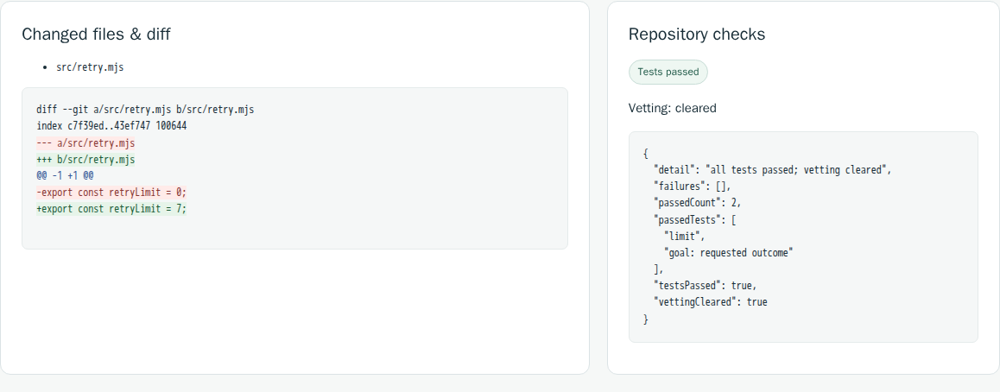

# Watch Keep work without installing it

The 53-second recording shows the installed **0.0.19-preview.1** console on October 21, 2026. Two authored local responses supply the edit and goal test. A browser fixture makes the sample approval and veto decisions. The recording makes no live model requests or paid calls.

https://github.com/RedRookAI/keep-research-preview/releases/download/keep-portfolio-2026-10-21.1/keep-account-free-demo.mp4

[Animated recording](images/account-free-demo.gif) · [Run and media identities](examples/account-free-console/recording.json)

## Text description

1. The console starts with no projects. The installed CLI submits: “Correct retryLimit in src/retry.mjs to seven; preserve unrelated behavior.” A labelled fixture page shows command output and source.
2. Keep waits for a step decision. The fixture clicks **Approve this step** before any generation response is requested.
3. Keep changes `retryLimit = 0` to `retryLimit = 7` in a separate workspace. The source remains at `0`.
4. The console displays the diff and two passing checks: **limit** and **goal: requested outcome**.
5. The fixture clicks **Veto proposal**. Keep records `local_merge.refused`, decision `veto`, with reason “operator vetoed the exact reviewed proposal.”
6. Filesystem readback confirms the unchanged source and edited workspace. A fresh worker recovers the same proposal and veto without replaying generation.

The [genuine Codex/OpenClaw case](genuine-codex-walkthrough.md) separately records live Codex generation.

## How the recording was made

The footage uses the installed runtime, a temporary synthetic repository and a loopback provider. It adapts the [installed walkthrough fixture](../acceptance/installed_solve.mjs). You can [run the account-free walkthrough](portfolio-walkthrough.md) yourself.

Pages labelled **recording fixture — not Keep UI** show CLI output, journal facts and file contents. Console footage is browser capture with captions below the viewport.

The video joins two labelled capture segments from the same retained job. The first recorder stopped after veto because it asserted the wrong reporting field. The continuation checks the original files and restart recovery without another solve or generation request. The [recording record](examples/account-free-console/recording.json) preserves that sequence.

The sample uses best-effort process isolation. See [security boundaries](../SECURITY.md) and [validation evidence](evidence.md) for the tested scope.
