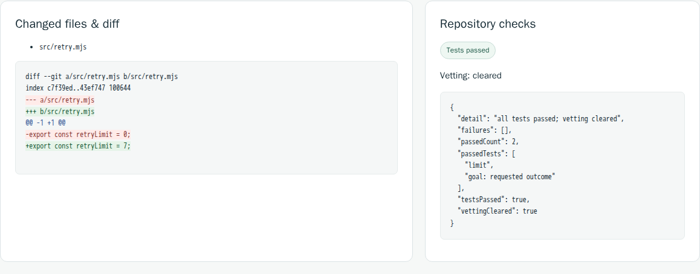

# Watch Keep work without installing it

[Watch the 53-second MP4](https://github.com/RedRookAI/keep-research-preview/releases/download/keep-portfolio-2026-10-21.1/keep-account-free-demo.mp4) · [Animated recording](images/account-free-demo.gif) · [Observed run and media identities](examples/account-free-console/recording.json)

This is a fresh October 21, 2026 recording of the installed **0.0.19-preview.1** console and a synthetic public repository. It uses **two authored local responses** in place of a model. An automated fixture **simulates the owner decisions through Keep's actual browser forms**. There are no external model requests, paid calls, hidden Codex generation or real user credentials in the recording.

## Text description

1. Keep's console starts with no projects. The actual installed CLI submits: “Correct retryLimit in src/retry.mjs to seven; preserve unrelated behavior.” A labeled fixture page shows the actual command output and source file.
2. The project waits for a step decision. No generation response has been requested. The fixture clicks **Approve this step** in the real console.
3. Keep applies the authored edit in a separate working copy: `retryLimit = 0` becomes `retryLimit = 7`. The original file still contains `0`.
4. The console displays the actual proposed diff and executable checks: **limit** and **goal: requested outcome** pass. These are real checks of a scripted edit, not a measure of model quality.
5. The fixture reviews and clicks **Veto proposal** for that exact proposal. Keep records `local_merge.refused`, with decision `veto` and reason “operator vetoed the exact reviewed proposal.” This is the intended refusal to merge after veto, not a failed approval.
6. Live filesystem readback shows an empty original Git diff and the separate edited workspace. A fresh owned worker then recovers the same proposal and veto record with no generation replay.

The native console, workspace files, checks and decisions are real. The local provider is an API-compatible loopback fixture; this video does not exercise Codex or OpenClaw. The [separate genuine Codex/OpenClaw case](genuine-codex-walkthrough.md) records real Codex generation and retains its original historical screenshot and execution identities.

## How the recording was made

The capture uses the existing installed runtime and browser tooling, with an owned temporary repository/data directory and loopback endpoints. It adapts the existing [installed walkthrough fixture](../acceptance/installed_solve.mjs); the [runnable account-free walkthrough](portfolio-walkthrough.md) remains available for deeper inspection. Keep's runtime and UI were not changed for the recording.

Console footage is actual browser capture. Pages explicitly labeled **recording fixture — not Keep UI** display actual CLI stdout, journal facts and live file contents; they are not additional product screens. Captions were added below the captured viewport. No successful screen or result was reconstructed, and no historical screenshot was presented as a new run.

The video joins two actual capture segments. The first recorder stopped after veto because its assertion incorrectly expected the reporting field to contain the bare string `veto`. Inspection of the existing projection and journal established the correct event/reason above. The original job, source, workspace and first recording were retained. The continuation verifies those same files and restart recovery; it does not submit another solve or replay generation. That continuation is labeled in the video and retained in the [recording record](examples/account-free-console/recording.json).

The sample uses the walkthrough's best-effort process boundary and one developer-administered fixture. It does not establish production containment, an independent audit or general model success rates. See [security boundaries](../SECURITY.md) and [validation evidence](evidence.md).
