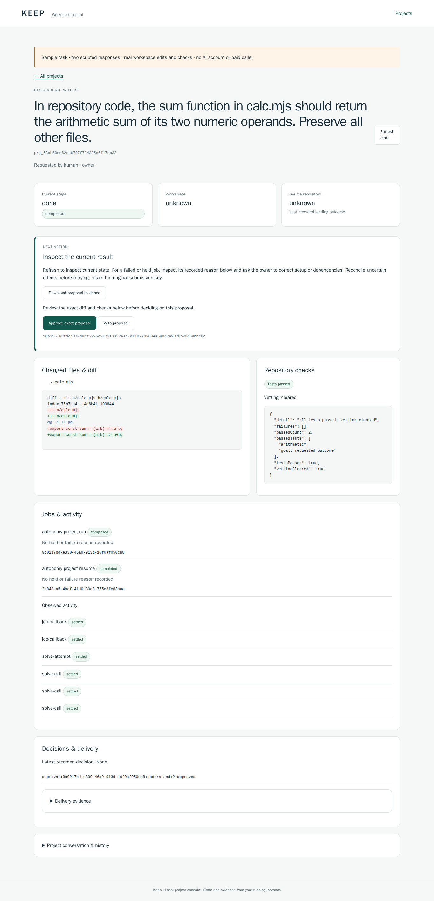

# Reviewer handover evidence — November 12, 2026

The hosted browser sample completed its actual public HTTPS qualification on source `fe14178df5ca1726ed13172236fe14fc181b4eef` (`0.0.24-preview.1`). Separately, a Debian 13 x64 guest ran the bundled generation engine and required sandbox together. The downloadable VM package is being built from that selected profile; its fresh-consumer and real-account acceptance are still pending.

## Interactive hosted sample

An operator assigns each reviewer a separate invitation credential and instance. The credential is entered into the sign-in form and is never part of the URL.

https://keep.redrook.ai/console

https://keep-b.redrook.ai/console

Two fresh Chromium 151.0.7922.34 contexts, with no saved maintainer cookies or accounts, each completed this sequence through Cloudflare HTTPS with certificate verification enabled:

1. Sign in, open the prefilled fixed goal and submit it.
2. Approve the pending step; inspect the actual arithmetic edit and the two unchanged executable checks.
3. Open a new goal form and recover the original project and job identities.
4. Veto the exact proposal and download its retained evidence through the browser.

Each instance used two authored responses and zero paid calls. Its original source remained unchanged; the separate workspace contained the correction. Export verification checked the proposal digest, passing checks and attributed decision. Every page disclosed the scripted sample.

Wrong invitation credentials, cross-origin and null-origin requests, forged CSRF, cross-instance cookies, and non-sample inputs were refused. Known invitation credentials could not open raw project, job, worker or authentication APIs. Cross-instance project reads, decisions, cancellation and exports were refused. Each instance retained one original submission and one explicit approval-resume job; a fresh form added neither a job nor provider responses.

The deployment uses two nonroot containers with separate writable state and read-only runtime mounts. Each private loopback listener has its own Cloudflare connector and exact public hostname. The main Red Rook site and its DNS records were preserved. The controlled authored-code sample uses Keep's existing best-effort process execution profile. Hostile-code production tenancy is outside this qualification.

After qualification, the operator retired each completed instance separately. Its launcher reported no unresolved jobs and exited cleanly; the other instance remained authenticated and available. Fresh roots and credentials replaced the invitations, and actual HTTPS browser checks confirmed that old credentials/cookies were refused and each new instance had zero projects. The completed states and exports remain retained.

The public browser receipt is `reviewer-hosted-2026-11-12.json`; `reviewer-hosted-lifecycle-2026-11-12.json` records retirement and fresh readiness. See `../reviewer-sample.md` for admission, credentials and lifecycle behavior.

## Selected downloadable runtime profile

The profile proof used the public `0.0.21-preview.1` combined archive, Node 22.23.4 and the measured Bubblewrap 0.13.0 helper. In the same Debian 13.7 guest, under UID 1000:

- The bundled `codex-cli 0.163.0-keep-generation.2` returned its version and an expected logged-out login status.
- Keep's actual required-sandbox preflight passed with launcher-confirmed namespaces and resource limits, no degraded guarantees and direct-child closure.
- No account credentials, model calls or host security-policy changes were used.

The observed host was an ephemeral Ubuntu 24.04 x64 GitHub runner using QEMU 8.2.2/KVM and machine `pc-q35-8.2`. The guest kernel was `6.12.116+deb13-amd64`. The fixture used two vCPUs, 2 GiB RAM and an 8 GiB virtual disk; those values are test settings, not measured customer minimums. Exact input hashes are in `reviewer-vm-profile-2026-11-12.json`.

https://github.com/RedRookAI/keep-research-preview/actions/runs/43132851687

This proves the selected Linux x64 qcow2 route's minimal joint engine/sandbox prerequisite. Browser access inside the shipping image, image sanitization, import, actual package size and fresh-account generation remain package acceptance work. Other hypervisors, Windows/macOS hosts, ARM64 and arbitrary Linux host policies are unqualified. Unsupported local hosts can use an assigned hosted browser invitation.

## Source checks and preserved failures

The `.24` public source checkpoint passed its 191-check partial CI profile with zero failures, skips or cancellations. This is distinct from native, full-product and exact-download qualification.

https://github.com/RedRookAI/keep-research-preview/actions/runs/43132779709

The VM proof preserves two earlier orchestration failures: a missing runner utility before boot, and a nested-shell readiness error followed by blocked cleanup. The corrected harness passed its focused failure checks before the successful fresh guest run. No sandbox policy was weakened to obtain the result.

The hosted qualification's first recorder stopped before sign-in because it incorrectly expected the public sign-in page to carry the authenticated console's cache header. The corrected recorder checks `no-store` on authenticated content; the original failure is retained. A first Cloudflare configuration read also returned a valid null configuration for a new tunnel; the controller was corrected before installing ingress. Neither failure is counted as a successful workflow.

The first retirement probe was refused by Cloudflare's browser-integrity check with code 1010 for the default Python client. No container was stopped in that attempt; the operator probe then used the qualified browser's User-Agent without changing Cloudflare policy. A fresh-state assertion initially assumed an empty sessions directory already existed; the corrected check accepts the absence of that lazily created directory as zero sessions. These recorder corrections did not submit another goal or change runtime guards.
